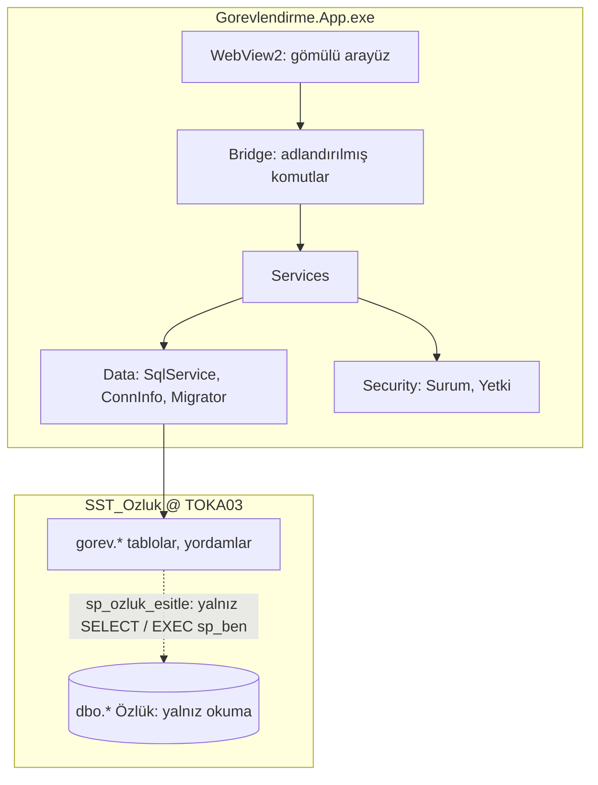
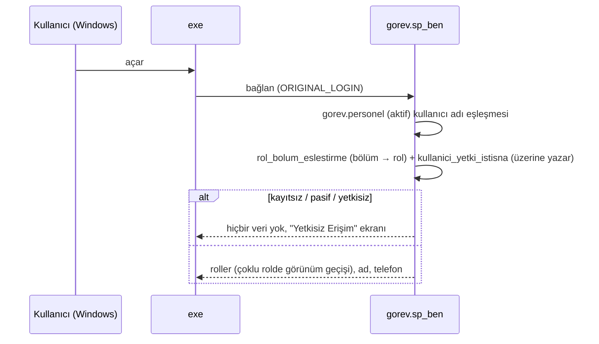

# Mimari

## 1. Katmanlar

Arayüz ham SQL göndermez. Uygulama `gorev` yordamlarını çağırır; yazma yalnız yordamla (`gorev_sahip` bağlamı).

## 2. Kimlik ve rol çözümü

Giriş denetimi yalnızca `gorev` tablolarına bakar (dbo okuması yok). En az 1 aktif yönetici zorunlu (tetikleyici).

## 3. Kadro eşitleme (`sp_ozluk_esitle`)
1. Çağıran: gorev yöneticisi **ve** Özlük'te aktif `yonetici` ya da tüm kurum kapsamlı (`kapsam_org_id` boş). Aksi halde hata.
2. `dbo.personeller` → `#ozluk` (beş alan + ayrılış durumu); `dbo.sp_ben` → `#ben` (rol doğrulaması). Özlük satır düzeyi güvenliği çağıranın kapsamıyla süzer.
3. Güvenlik kapısı: okunan satır < aktif `gorev.personel` sayısının %80'i ise iptal.
4. `MERGE gorev.personel` (sicil_no anahtar): ekle, güncelle, ayrılanı pasife al; asla silme. Başarıda `son_esitleme` ayarı güncellenir.
5. Tetik: Özlük yöneticisi girişinde otomatik + "Kadroyu Özlük'ten eşitle" düğmesi. Diğerlerinde düğme kapalı, "son eşitleme" görünür.

## 4. Ortam ve sıfırlama
`gorev.sistem_ayarlari.ORTAM` (`TEST`/`CANLI`) sıfırlama betiklerini korur; ayrıntı `docs/SQL.md` §5.

## 5. Eşzamanlılık
Onay/atama yordamları `SERIALIZABLE` + `UPDLOCK`: aynı personel, aynı gün ve dilimde çakışma sunucuda yakalanır (rapor 50002, izin 50003, atama 50004). Ekranlar 30 sn'de bir yenilenir (`rowversion` ile değişiklik yoklaması; yalnız değişen veri çekilir).

## Dilim 1 ekleri
- **Kurulum sırası:** `Migrator.UygulaAsync` → (1) sahip kontrolü: `gorev` şeması başka sahiple varsa dur; (2) `CREATE USER gorev_sahip WITHOUT LOGIN`, `CREATE SCHEMA gorev AUTHORIZATION gorev_sahip`, `gorev.sema_surumleri`; (3) bekleyen betikler, her biri ayrı işlemde ve `sp_getapplock 'gorev_sema'` altında.
- **Sürüm kapısı:** `gorev.sp_surum_bilgi` (herkes çağırır) → `Surum.Denetle(uygulama, MIN_UYGULAMA_SURUMU, şema, hedef)` → engel `AppState.Engel`'e yazılır, `kapiGerekli` komutlar reddedilir.
- **Okuma/yazma:** `gorev_kullanici` yalnızca `EXECUTE ON SCHEMA::gorev` alır; tablolara doğrudan yetkisi yoktur. Yordamlar `WITH EXECUTE AS OWNER` (= `gorev_sahip`) çalışır; `ORIGINAL_LOGIN()` gerçek bağlanan hesabı verir.

## Dilim 2: kimlik ve arayüz katmanı
- C#: `KimlikService` (`gorev.sp_ben`), `KadroService` (kadro/eşleştirme/istisna yordamları), `Gorunum` (rol→görünüm listesi ve varsayılan), `SqlHata` (sunucu hata no → arayüz kodu), `SqlService.ProcAsync` (yalnız adlandırılmış yordam), `KimlikCommands` (köprü; hepsi sürüm kapısına tabi).
- Arayüz (`ui-src/app/`): 001 köprü, 002 ortak (h(), durum, toast), 003 sistem, 004 kadro/eşleştirme/istisna, 005 kabuk (başlık, ORTAM rozeti, görünüm menüsü, menü), 006 başlangıç (sürüm durumu → `ben` → Yetkisiz ya da kabuk). Yetki kararı sunucudadır; arayüzdeki menü yalnızca görünümdür.

## Dilim 3: havuz ve takvim
- SQL `004_havuz_takvim.sql`: `proje_havuzu` (ağaç, `ust_id` + `seviye` CHECK, kardeşler arası tekil ad: iki filtreli tekil dizin), `takvim_tatil` (004 ilk sürüm: tarih+dilim; 005 ile yeniden kuruldu, aşağıya bakın), `fn_kayitli_mi()` (`sp_ben` ile aynı rol çözümü; listeleme yordamlarının kapısı), yazma yordamları `fn_yonetici_mi()` ile kilitli. Geçici tablolar `COLLATE DATABASE_DEFAULT` (tempdb harmanlaması farklı olabilir; CI bunu yakaladı).
- Birleştirme yumuşaktır: kaynak silinmez, pasif olur ve `birlestirildi_id` hedefi gösterir; Dilim 4+ tabloları eski kimliği buradan çözer.
- C#: `HavuzService`, `TakvimService`, `TakvimCozumleyici` (iki kip: STANDART = resmi takvim tablosunun liste satırları, günler/aralık/yarım gün/yıllık izin işareti ve yıl hücresi; TABLO = sütunlu CSV/TSV, başlık varsa adından; Türkçe I/İ katlama), `XlsxOkuyucu` (ZipArchive+XDocument, DTD kapalı, 50 MB girdi / 20 000 satır sınırı, tarih biçimli sayıları ISO'ya çevirir). Sunucu yine her satırı doğrular.
- SQL `005_takvim_standart.sql` (takvim revizyonu, 18.11.2026; kullanıcının 2024_Takvim.xlsx standardı): `takvim_tatil` aralıklı kayıt olur (`baslangic`, `bitis`, `zaman_dilimi`, `tur` RESMI/IDARI, `yillik_izinden_kesilir`); AKADEMIK türü kalktı (eski satırlar IDARI'ye, tek günlük kayıt olarak taşındı). CHECK: bitiş≥başlangıç, tek yıl, <60 gün, yarım gün yalnız tek günde. `fn_takvim_cakisma` (ÖÖ+ÖS serbest), `fn_is_gunu` (DATEFIRST'ten bağımsız hafta içi sayımı), `sp_takvim_ozet`. Yıllık izin toplamı yalnız bilgidir.

## Talep (Dilim 4)
- SQL `006_talep.sql`: `talepler` (`kod` = TLP-NNNN hesaplı sütun, `sorumlu_sicil_no`, `havuz_id` = Konum yaprağı; üst zinciri Ana Proje › Alt Proje › Faaliyet), `talep_gunleri` (PK talep+tarih+dilim; kişi sayısı 1–500), `talep_oneri`, `gecmis_gorev` (tarihsiz eski geçmiş; şimdilik boş). Durumlar CHECK'te hepsi tanımlı; bu dilim yalnız TASLAK/ONAY_BEKLIYOR/GERI_CEKILDI üretir.
- Yordamlar `WITH EXECUTE AS OWNER`: `sp_talep_kaydet` (SERIALIZABLE; gün/öneri JSON'u OPENJSON; havuz yolunu çözer/oluşturur; logu yazar), `sp_talep_geri_cek`, `sp_talep_listele`, `sp_talep_getir` (gün ve öneriler JSON sütunu: tek sonuç kümesi), `sp_personel_ara`. Yardımcı işlevler: `fn_ben_sicil`, `fn_sorumlu_mu` (sp_ben ile aynı çözüm).
- C#: `TalepService`, `TalepCommands`. Arayüz: `ui-src/app/004_talep.js` (liste + form; form sağda yazdıkça güncellenen Özet kartı (📍🕣📅📑📡🙋‍♀️🧍‍♂️) taşır; form alanları kontrolsüz girdi, durum değişiminde önce `oku()` ile DOM'dan alınır).

## Atama (Dilim 5)
- SQL `007_atama.sql`: `atamalar` (gün + dilim bazlı satır; durum AKTIF/CIKARILDI; filtreli tekil dizin AKTIF için; çıkarma izi: kim/ne zaman/neden/hangi talep), `bildirimler`, `talepler.ret_nedeni`. İşlevler: `fn_havuz_ana`, `fn_talep_durum` (0 atama → ONAY_BEKLIYOR; istenen sayıya ulaşınca TAMAMEN_ATANDI; arası KISMEN_ATANDI), `fn_atama_cakisma` (TAM her dilimle, ÖÖ–ÖS birbiriyle örtüşmez).
- `sp_atama_onayla`: SERIALIZABLE + UPDLOCK; doğrular (talepte olan gün/dilim, kapasite, pasif kişi, tekrar, aynı talepte aynı gün), çakışmada `REDDET` → 50030, `CIKAR` → çakışan atamalar CIKARILDI + sorumluya bildirim + log (ATAMA_CIKAR); başarıda TALEP_ATAMA logu, sorumluya ATANDI bildirimi, tatil uyarısı döner. `sp_talep_reddet` (neden zorunlu), `sp_atama_adaylar`, `sp_atama_cakisma_kontrol`, `sp_bildirim_listele/okundu`. `sp_talep_listele/getir` atama sayıları, atananlar (iç içe JSON) ve ret nedeniyle genişletildi.
- Arayüz: `ui-src/app/004_atama.js` (panel; çakışma karar kutusu sunucunun `cakisma` hatasına da tepki verir), talep listesinde Yönetici için Ata/Reddet, Sorumlu için Atananlar ve bildirim bandı. İzin/rapor çakışması Dilim 7'de aynı karar akışına eklenir (reddedilir, çıkarma seçeneği yok).

## Haftalık matris (Dilim 6)
- SQL `008_matris.sql`: `atamalar.surum` (ROWVERSION), `fn_hafta_basi` (pazartesi; `DATEFIRST`'e bağlı değil), `sp_matris_hafta` (personel satırı + hücreler JSON; filtreler bölüm/Ana Proje/ad/yalnız görevli), `sp_matris_surum`, `sp_matris_bolumler`. Yalnız okuma; kayıtlı her rol (`fn_kayitli_mi`).
- Arayüz `004_matris.js`: hafta gezinmesi (◀ ▶, Bu hafta, GG.AA.YYYY), filtreler, ÖÖ/ÖS bölünmüş hücre (TAM tek blok), Ana Proje renkleri (ad hücrede yazılı), tatil sütunu, günlük görevli sayısı, hücre ayrıntısı. 30 sn'de bir yalnız `matrisSurum` sorulur; değişmişse matris yeniden çekilir; sayfa DOM'dan kalkınca sayaç durur.
- Excel: `MatrisExcel` (paketsiz ZipArchive + XML, SQL'siz birim testli); kayıt penceresi `MatrisCommands` içinde STA iş parçacığında açılır.

## Eski veri denetimi (Dilim 3b)
`EskiVeriOkuyucu` (Microsoft.Data.Sqlite, `Mode=ReadOnly`, eksik tablo/sütuna dayanıklı) → `EskiVeri` bellek modeli → `EskiVeriDenetimi.Raporla` (saf mantık: personel eşleşmesi sicil→ad, atama çözümleme, kişi+gün çakışması, sorumlu eşleşmesi, proje ağacı derinlik/yetim/döngü/kardeş tekrarı) → `EskiVeriRaporu` (sayılar + düz metin). Komut `eskiVeriDenetle` dosyayı STA iş parçacığında seçtirir; kadro ve havuz bilgisi `sp_kadro_listele` / `sp_havuz_listele` ile okunur (SQL'e yazılmaz).

## İzin ve rapor (Dilim 7)
- Tablolar `izin_talepleri`, `izin_gunleri` (gün/dilim bazlı), `raporlar` (evrak `varbinary(max)`). Yazma `EXECUTE AS OWNER` yordamlarla; `sp_izin_isle` içsel ortak onay mantığıdır.
- `tr_atamalar_izin_rapor`: onaylı izinli ya da raporlu güne atama eklenirse 50031 (`izin_rapor`) ile reddedilir; sunucu son savunmadır.
- Rapor kazanır: kayıt anında aralıktaki izin günleri IPTAL olur. Çakışan atamalar otomatik silinmez; Yöneticiye "ikame gerekli" bildirimi gider.
- Evrak yolu: arayüz dosya yolunu (`raporEvrakSec`) taşır, baytları C# okur (`IzinRaporService.EvrakTuru`: uzantı + dosya imzası + boyut).
- `matrisSurum` izin/rapor değişimini de içerir; matris izinleri gri, raporu kırmızı blok gösterir.

## Revize, iptal, ikame (Dilim 8)
- `revize_talepleri` (tek bekleyen revize/talep), `sorumlu_devir` (geçmiş). Yazma `EXECUTE AS OWNER` yordamlarla; `sp_revize_uygula` içsel ortak uygulama mantığıdır.
- İkame, eski kişinin atamalarını kapatıp `sp_atama_onayla`yı çağırır; kapasite, çakışma kararı ve izin/rapor tetikleyicisi tek yerde kalır. `REDDET` çakışması iç yordam çağrılmadan önce 50030 ile denetlenir.
- İptal yalnız hiç günü geçmemiş talepte; başlamış görev "erken bitiş" ile kısaltılır. Atamalar silinmez, `CIKARILDI` olur (neden ve çıkaran kaydıyla).

## Analiz ve arşiv (Dilim 9)
- `011_analiz.sql` yalnız okuma yordamlarıdır (tablo eklemez). Kapsam sunucuda uygulanır: Yönetici tümü, Sorumlu `talepler.sorumlu_sicil_no = ben`, Saha 50023.
- Adam-gün hesabı SQL'dedir (`TAM → 1,0`, diğer `0,5`); arayüz yalnız gruplar ve toplar. Excel tabloları `AnalizService.*Tablo` ile (saf, birim testli); `MatrisExcel.Xlsx` sayısal hücre ve sütun dondurma parametresi aldı.

## Canlıya geçiş ve aktarım (Dilim 10)
- `012_canli_aktarim.sql`: `fn_canli_kontrol` (8 madde; 1–4 zorunlu: ortam TEST, yönetici var, kadro dolu, havuzda konum var), `sp_ortam_canli` (onay `CANLI`, kontrol eksikse 50024, ORTAM=CANLI + isteğe bağlı asgari sürüm, log), `sp_eski_aktar` / `sp_eski_aktar_durum` / `sp_eski_aktar_geri_al`. Hepsi `EXECUTE AS OWNER`, yetki `fn_yonetici_mi()`.
- Aktarım planı C#'ta (`EskiAktarim.Planla`, saf mantık, birim testli) JSON üretir; SQL tek işlemde doğrular ve yazar. Her kayıt `kaynak='ESKI_ARAC'` (tarihsiz geçmiş `ESKI_ARAC_TARIHSIZ`). Geri alma yalnız bunları ve kullanılmayan aktarım havuz satırlarını siler (alt seviyeden üste).
- Aktarım ve geri alma yalnız `ORTAM='TEST'`; canlıda reddedilir. Canlıdan TEST'e dönüş uygulamada yoktur: `tools/sql/gorev_geri_donus.sql` (db_owner, elle).

## Senaryo tamamlama (Dilim 11)
- `013_senaryo_tamamlama.sql`: `nitelik` sütunları 1000 karakter (arayüzde "Saha / Operasyon Notu"); `sp_talep_kaydet/revize_*` statik kopyalarla güncellenir (dinamik SQL yok, dbo koruma temiz); yeni `sp_talep_iletisim`, `fn_ikame_bekleyenler`, `sp_ikame_bekleyenler`, `sp_sayaclar`; `sp_analiz_personel`, `sp_atama_adaylar`, `sp_rapor_evrak`, `sp_matris_hafta` genişletildi.
- Arayüz: menü rozetleri `sayaclar` ile; 30 sn zamanlayıcı (`S.zaman`) yalnız odak giriş alanında değilken sayfanın `S.yenile` kancasını çağırır.
