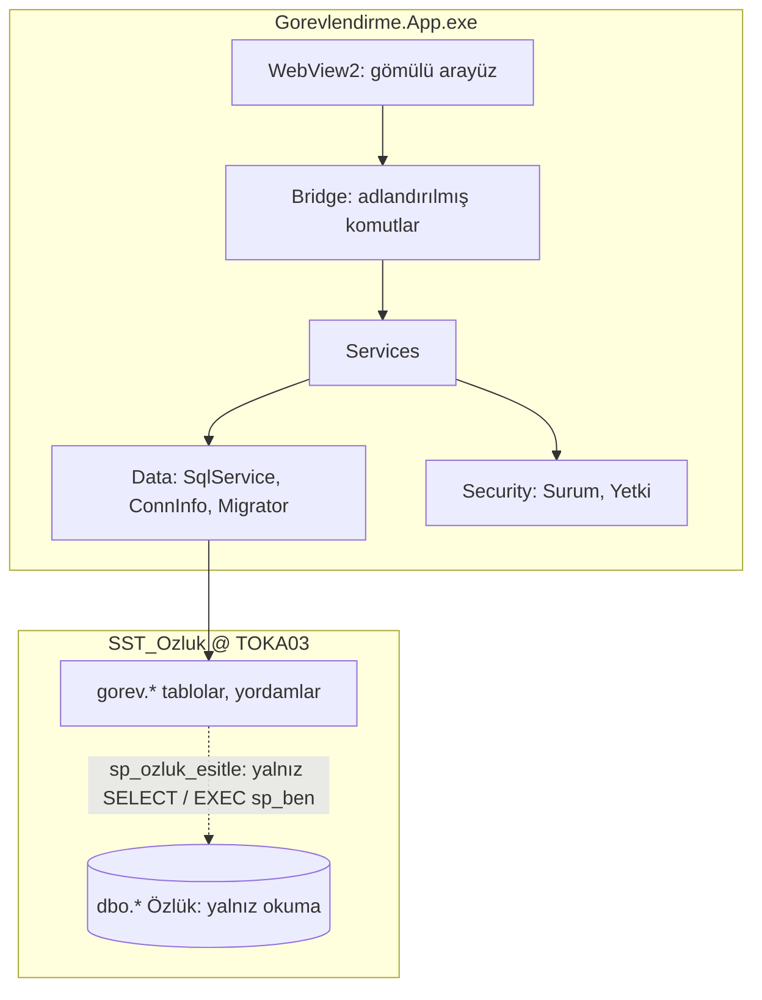
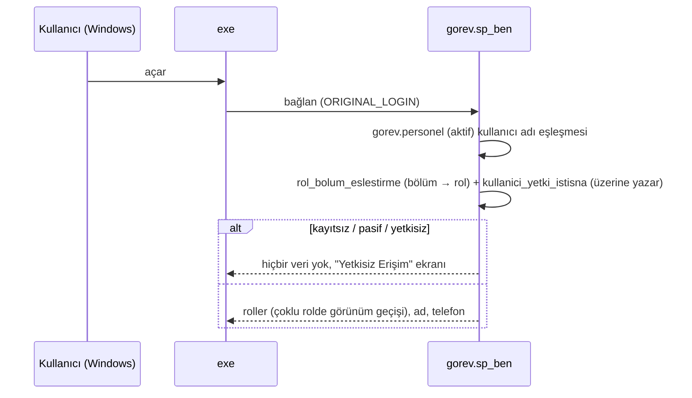

# Mimari

## 1. Katmanlar

Arayüz ham SQL göndermez. Uygulama `gorev` yordamlarını çağırır; yazma yalnız yordamla (`gorev_sahip` bağlamı).

## 2. Kimlik ve rol çözümü

Giriş denetimi yalnızca `gorev` tablolarına bakar (dbo okuması yok). En az 1 aktif yönetici zorunlu (tetikleyici).

## 3. Kadro eşitleme (`sp_ozluk_esitle`)
1. Çağıran: gorev yöneticisi **ve** Özlük'te aktif `yonetici` ya da tüm kurum kapsamlı (`kapsam_org_id` boş). Aksi halde hata.
2. `dbo.personeller` → `#ozluk` (beş alan + ayrılış durumu); `dbo.sp_ben` → `#ben` (rol doğrulaması). Özlük satır düzeyi güvenliği çağıranın kapsamıyla süzer.
3. Güvenlik kapısı: okunan satır < aktif `gorev.personel` sayısının %80'i ise iptal.
4. `MERGE gorev.personel` (sicil_no anahtar): ekle, güncelle, ayrılanı pasife al; asla silme. Başarıda `son_esitleme` ayarı güncellenir.
5. Tetik: Özlük yöneticisi girişinde otomatik + "Kadroyu Özlük'ten eşitle" düğmesi. Diğerlerinde düğme kapalı, "son eşitleme" görünür.

## 4. Ortam ve sıfırlama
`gorev.sistem_ayarlari.ORTAM` (`TEST`/`CANLI`) sıfırlama betiklerini korur; ayrıntı `docs/SQL.md` §5.

## 5. Eşzamanlılık
Onay/atama yordamları `SERIALIZABLE` + `UPDLOCK`: aynı personel, aynı gün ve dilimde çakışma sunucuda yakalanır (rapor 50002, izin 50003, atama 50004). Ekranlar 30 sn'de bir yenilenir (`rowversion` ile değişiklik yoklaması; yalnız değişen veri çekilir).
